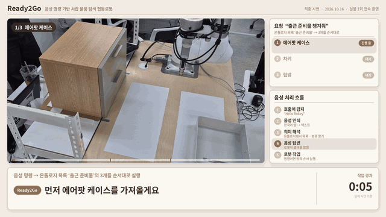
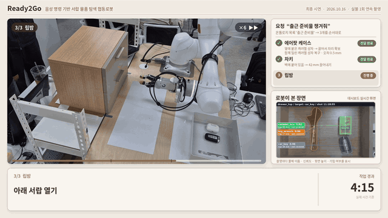
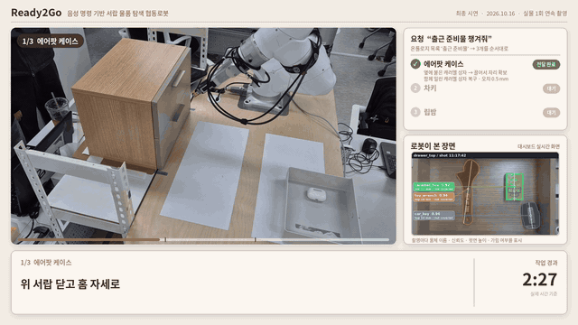
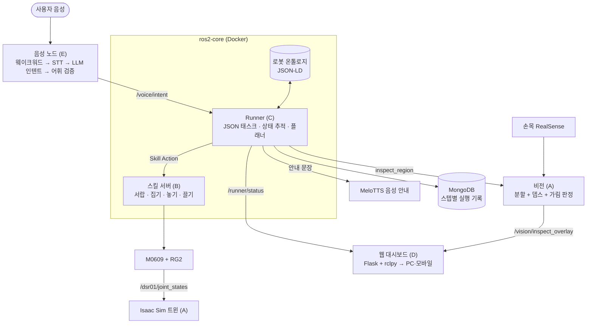
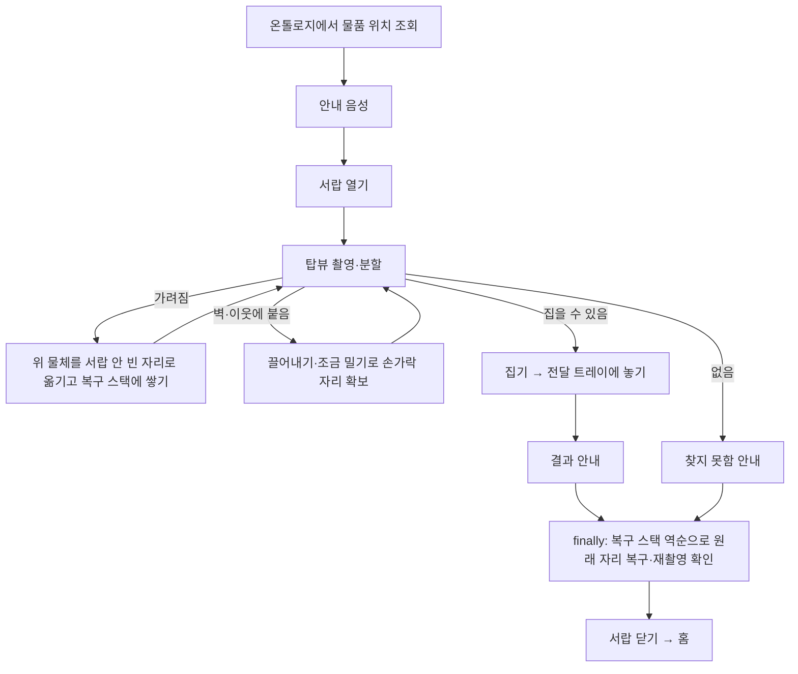
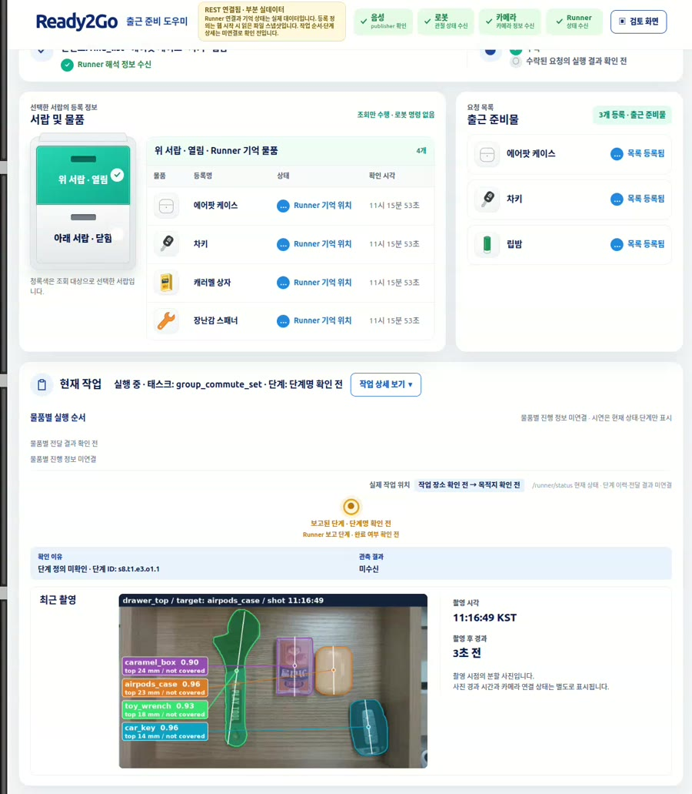
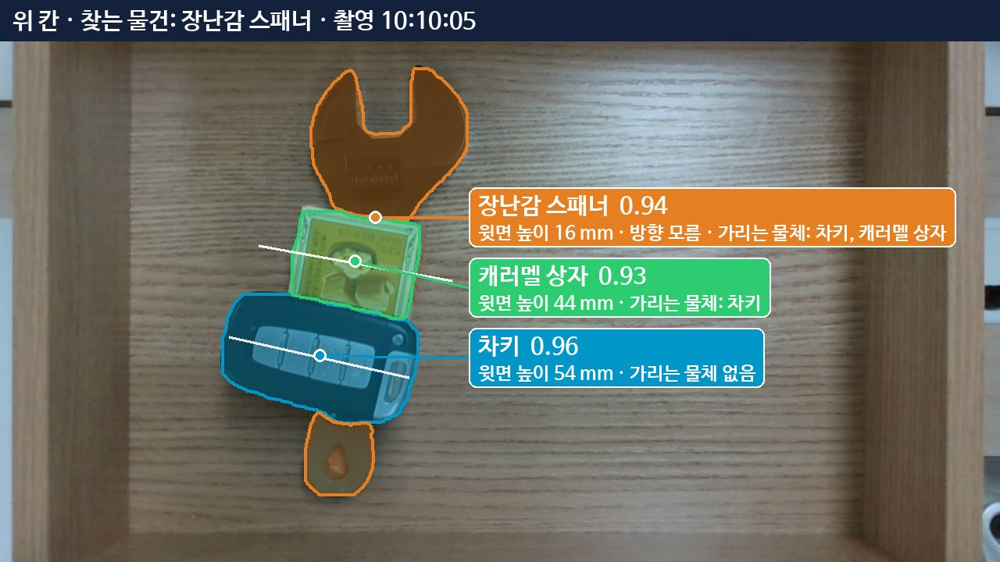
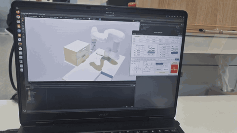
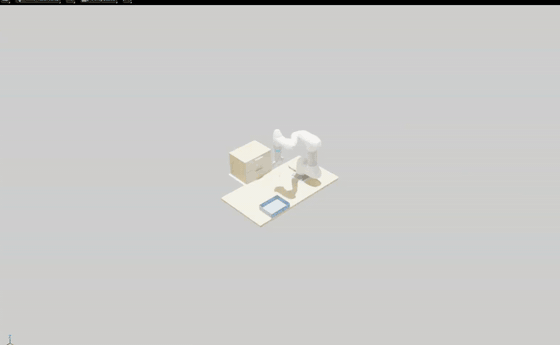

# Ready2Go — 음성 명령 서랍 물품 탐색 협동로봇

> 두산 부트캠프 협동로봇 프로젝트 · 2026.10.02 ~ 10.16 (14일 스프린트) · 5인 팀

*10/16 최종 시연 편집본 일부(로봇 이동 구간 배속). 왼쪽은 실물 셀, 오른쪽 위는 요청 목록, 오른쪽 아래는 로봇 손목 카메라가 본 장면입니다.*

"헬로 로키, 출근 준비물 챙겨줘"라고 말하면, **실물 Doosan M0609 + OnRobot RG2**가 서랍장을 열어 등록된 물건을 찾아 전달 트레이에 놓고, 치웠던 물건은 원래 자리로 되돌린 뒤 서랍을 닫습니다.

로봇이 할 수 있는 동작과 세계 상태는 **JSON-LD 온톨로지**로 정의합니다. 명령은 그 동작들을 조합한 **JSON 태스크**로 실행되고, 모든 스텝의 성공 여부와 전후 상태는 **MongoDB**에 기록됩니다. 서랍 안에서 물건이 다른 물건에 가려져 있거나 벽·이웃 물체에 붙어 있으면, 비전이 그 관계를 판정하고 로봇이 장애물을 치우거나 물체를 끌어내 집을 공간을 만듭니다.

## 최종 시연 결과 (10/16)

요청 "출근 준비물 챙겨줘" — 온톨로지에 등록된 목록 `출근 준비물`(에어팟 케이스·차키·립밤)을 순서대로 한 번에 수행했습니다. 실물 1회 연속 촬영입니다.

| 항목 | 결과 |
|---|---|
| 전달 | **3 / 3** — 에어팟 케이스(위 서랍), 차키(위 서랍), 립밤(아래 서랍) |
| 소요 시간 | 요청 수락부터 작업 완료까지 **6분 27초** |
| 상황별 대응 | 에어팟 케이스: 옆에 붙은 캐러멜 상자 때문에 손가락 자리가 없음 → 앞으로 끌어 자리 확보 · 차키: 벽에 너무 붙음 → 42 mm 끌어내기 · 립밤: 덮개 판 밑에 가려짐 → 판을 먼저 치움 |
| 원위치 복구 | 치운·함께 밀린 물체 2건을 원래 자리로 복구 — 위치 오차 **0.5 mm / 2.8 mm** |
| 실행 기록 | 물품별 실행 3건 모두 `COMPLETED`, 스텝 기록 154 · 90 · 119개, 누락 점검 0건 |
| 자동 시험 | pytest 3,630건 통과 · 44건 건너뜀, 계약·Compose·colcon 빌드 확인 (로컬 CI `tools/dev/ci_local.sh`, 10/16). 모의 환경 시험이라 실제 힘·파지·충돌 성능을 입증하지는 않습니다 |
| 음성 질의 | "출근 준비물에 뭐 있어?" → "에어팟 케이스, 차키, 립밤이에요" · "귀중품은 뭐야?" → "귀중품은 차키예요" (온톨로지 목록·분류 조회) |

<table>
<tr>
<td width="50%"></td>
<td width="50%"></td>
</tr>
<tr>
<td><b>가림 탐색·원위치 복구</b> — 덮개 판 밑의 립밤. 판을 치우고 다시 촬영해 립밤을 집고, 전달 뒤 판을 원래 자리로 되돌립니다.</td>
<td><b>집을 공간 만들기</b> — 벽에 붙은 차키는 바로 집을 수 없어 42 mm 끌어낸 뒤 집습니다.</td>
</tr>
</table>

## 핵심 기능

- **음성 + LLM 명령 해석** — 웨이크워드 → STT → LLM 인텐트 파싱(규칙 폴백) → 온톨로지 어휘로 검증. 단일 물품·목록(`출근 준비물`)·분류(`귀중품`) 요청과 목록·분류 질의를 처리하고, 진행·결과를 한국어 TTS로 알립니다.
- **로봇 온톨로지 + 동작 조합** — 스킬마다 사전 조건·결과(effect)를, 서랍·그리퍼·물품의 상태와 세계를 JSON-LD로 정의합니다. 탐색형 작업은 변수·`if`·`while`·`for_each`·`finally` 제어 블록을 가진 JSON 태스크로 표현해, 코드를 고치지 않고 새 작업을 등록합니다.
- **가림 판정 비전** — 손목 RealSense + 인스턴스 분할 모델(`yolo11s-seg`)로 물체마다 서랍 좌표 위치·방향·윗면 높이를 내고, 마스크와 뎁스로 "무엇이 무엇을 덮고 있는지"(`occluded_by`)와 보이는 넓이를 판정합니다.
- **Unpacking + LIFO 원위치 복구** — 목표가 가려져 있으면 위 물체부터 서랍 안 빈 자리로 옮기며 다시 촬영하고, 전달 뒤 옮긴 순서의 역순으로 원래 자리에 되돌립니다. 실패해도 `finally` 블록에서 복구를 시도합니다.
- **집을 공간 만들기** — 목표가 벽이나 이웃 물체에 붙어 손가락이 들어갈 자리가 없으면, 놓기 전에 판단만 하는 사전 검사로 이를 감지하고 물체를 끌어내거나(`sweep`·`nudge`) 재촬영해 자리를 확보합니다.
- **실행 기록** — 모든 스텝의 시각·결과·오류 코드·조건 확인·전후 상태를 MongoDB에 남기고(장애 시 JSONL 폴백), 회차별 표와 누락 점검 도구로 확인합니다.
- **정지·복구 안전 경로** — 음성 정지·외력 정지 뒤 상태를 보존하고, 조건이 확인될 때만 음성으로 복구·재개·종료를 받습니다.
- **Isaac Sim 디지털 트윈** — 실측 치수로 만든 서랍장 씬에서 스킬 흐름 궤적과 Unpacking 동작을 실물 투입 전에 재생해 문제를 찾고, 실물 관절 상태를 실시간으로 미러링합니다.
- **PC·모바일 웹 대시보드** — Runner 상태·서랍과 물품·요청 목록·현재 작업·최근 촬영 분할 사진을 읽기 전용으로 보여 줍니다.

## 시스템 구성

- 팀이 작성한 소프트웨어는 Docker Compose 프로파일(`realsense`·`ros2-core`·`db`·`vision-node`)로 띄우고, 음성 노드와 Isaac Sim은 호스트에서 실행합니다. ROS 2 Jazzy · CycloneDDS(Domain 70).
- 원자 동작은 `real` / `sim` / `mock` 백엔드 뒤에 있어, 같은 JSON 태스크를 실물·트윈·GPU 없는 모의 환경에서 실행합니다.

### 한 물품을 찾는 흐름 (`find_with_unpack`)

## 화면

| 웹 대시보드 (최종 시연 중) | 촬영 분할 오버레이 |
|---|---|
|  |  물체마다 이름·신뢰도·윗면 높이·가림 관계를 표시하고, 웹이 촬영마다 갱신합니다. |

## Isaac Sim 디지털 트윈

| 실물 관절 미러링 | Unpacking 사전 검증 |
|---|---|
|  |  |
| 실물 드라이버의 `/dsr01/joint_states`(약 100 Hz)를 받아 트윈이 따라갑니다(10/11, 조그 이동). | 스킬 서버 코드의 이동 명령과 실물 촬영 인식 결과로 Unpacking을 강체 물리로 재생해, 복구 높이·기울임 문제를 실물 전에 찾았습니다(10/13). |

트윈은 보조 경로입니다. 접촉·마찰·힘 제어·실제 파지 성공·뎁스 결손은 검증하지 못하며 실물 시험으로만 확인했습니다([twin.md](docs/twin.md)).

## 기술 스택

| 구분 | 사용 기술 |
|---|---|
| 로봇 | Doosan M0609 + DSR ROS 2 드라이버, OnRobot RG2(Modbus), 손목 Intel RealSense D435i |
| 프레임워크 | ROS 2 Jazzy, CycloneDDS, Docker Compose |
| 비전 | Ultralytics YOLO11s-seg(실물 데이터 직접 수집·라벨링), 정렬 뎁스, 핸드-아이 캘리브레이션, OpenCV |
| 태스크·지식 | Python JSON Runner + `jsonschema`, JSON-LD 온톨로지, BFS 플래너 |
| 음성·LLM | openWakeWord("헬로 로키"), Silero VAD, OpenAI Whisper STT, LangChain + GPT-4o 인텐트 파서(규칙 폴백), MeloTTS(한국어) |
| 기록 | MongoDB 7 + pymongo, JSONL 폴백 |
| 트윈 | NVIDIA Isaac Sim 5.1.0 |
| 웹 | Flask + rclpy 브리지, HTML/CSS/JavaScript |

## 팀과 역할

| 이름 | 역할 | 맡은 영역 |
|---|---|---|
| 고희태 (조장) | 통합 지휘 · 음성 · LLM · 온톨로지 | `ready2go_voice` · `ready2go_knowledge` · `knowledge/` |
| 김병직 | 비전 · Isaac Sim 트윈 | `ready2go_vision` · `sim/` |
| 서동권 | 실물 로봇 모션 | `ready2go_skills` · `config/` 포즈·장소·파지 설정 |
| 이영훈 | Runner · 플래너 · 기록 · 기술 통합 | `ready2go_runner` · `ready2go_interfaces` · `tasks/` · `tools/dev/` |
| 김민준 | 웹 대시보드 · 기록 · 평가 자료 | `web/` · `practice/D/` |

**고희태** — 통합 우선순위·체크포인트 판정과 요구사항 정본 관리, 서랍장·물품 준비.
- 음성 파이프라인: 웨이크워드 → Whisper STT → GPT-4o strict JSON 해석 → 등록 어휘 검증 → 규칙 폴백, MeloTTS 문장 캐시
- 로봇 온톨로지(스킬·물품·목록), TTL 기반 분류·목록 조회
- 음성 정지·복구·재개·종료 흐름과 Runner 연결

**김병직** — 손목 카메라부터 물체 판정까지의 비전과 디지털 트윈.
- 손목 RealSense 연결·핸드-아이 캘리브레이션, 실물 데이터 직접 수집·라벨링, YOLO 검출 → 인스턴스 분할(v2) 학습
- `inspect_region`: 서랍 좌표 위치·방향·윗면 높이(손끝 정답 대비 1.1~3.2 mm, 반복 0.2 mm), 가림 관계·보이는 넓이 판정, 촬영 분할 오버레이
- 실측 서랍장 트윈 씬, 실물 관절 미러링, 스킬 궤적·Unpacking 사전 검증

**서동권** — 실물 로봇이 하는 모든 원자 동작.
- DSR 드라이버 컨테이너·RG2 연결, 스킬 서버(서랍 개폐·집기·놓기·끌기·놓침 감지, 취소·비상정지·움직이기 전 거부)
- 힘 기준으로 눌러 끌어낸 뒤 집기, Unpacking 동작(빈 자리 놓기·원위치 되돌리기·바꿔 잡기)
- 둘러싸인 물체를 위한 `make_room`(넛지 → 밀기 → 치우기), 실물 조그 GUI

**이영훈** — 명령을 실행으로 바꾸는 프레임워크와 통합 환경.
- JSON 태스크 Runner(변수·조건·`while`·`for_each`·`fallback`·`finally`, 실행 전 검사), 스킬 조건·결과 기반 상태 추적, MongoDB 실행 기록
- BFS 스킬 플래너·묶음 계획, `find_with_unpack` 태스크(놓을 자리 사전 판단·역순 복구)
- 정지·복구·재개·종료 계약, 실행 보고서·누락 점검, 목록·분류 실행, 실물 실행 스크립트

**김민준** — 실행 상태를 보여 주는 웹과 평가·기록 자료.
- PC·모바일 반응형 대시보드, Flask + rclpy 상태 브리지와 등록 정의 조회
- 요청과 실행 결과의 `run_id` 연결 판정, 촬영 오버레이 캐시·표시, 물품별 실행 순서·단계명 UI
- 시나리오 체크리스트 검증기, 음성 평가 문장 세트, 회의록·결정 로그

GitHub에서 머지한 PR은 321건(문서·작업 기록 포함), 커밋은 1,900여 개입니다. PR은 대부분 다른 팀원의 리뷰를 거쳐 머지했고, 작업 규칙과 문서 정합성 기준은 [AGENTS.md](AGENTS.md)에 있습니다.

## 한계와 향후 과제

- **완료·검증 범위** — 최종 시연은 리허설에서 확인한 배치로 진행했습니다. 무작위 배치에서는 이웃 물체가 너무 가까워 거부(`NEIGHBOR_TOO_CLOSE`)하거나 공간 만들기 반복 상한에 걸린 회차가 있었고, 손잡이 쪽 앞벽에 뭉친 배치는 실물에서 실패했습니다. 공간 만들기의 무작위 배치 성공률 개선(약 30 % → 68 %)은 시뮬레이션 220회 결과입니다.
- **정지 뒤 복구** — 동작 사이 정지 후 음성 복구·종료 연결은 마지막 날 반영했고, 외력 정지 판정 오탐 보완은 리뷰 중입니다. 정지 후 실음성 복구는 실물에서 다시 확인해야 합니다.
- **완전히 가려진 물체** — 판정이 애매할 때 사용자에게 물어 치울 물체를 정하는 질문·답 대기 계약은 설계 단계입니다.
- **트윈** — 관절 미러링은 조그 이동만 확인했고, 그리퍼·서랍 상태 연동과 `BACKEND=sim` 사전 검증 실행은 남았습니다.
- **웹** — 목록 요청 중 물품별 단계명, 실행 상세 조회 화면은 후속입니다.

남은 일 전체는 마무리 이슈 [#398](https://github.com/Jik-Kim/ready2go/issues/398)에서 추적합니다.

## 문서와 실행

- 실행 안내(준비·전체 실행 순서·노드별 명령·로그·종료): [docs/run.md](docs/run.md)
- 문서 인덱스: [docs/README.md](docs/README.md) · 요구사항 정본(P1·P2·P3, 수용 기준): [docs/requirements.md](docs/requirements.md)
- 주제별: [아키텍처](docs/architecture.md) · [온톨로지](docs/ontology.md) · [Runner](docs/runner.md) · [플래너](docs/planner.md) · [비전](docs/vision.md) · [음성·LLM](docs/voice_llm.md) · [트윈](docs/twin.md) · [안전](docs/safety.md) · [선행 사례 조사](docs/research/prior_art_report.md)

## 저장소 구조

| 경로 | 내용 |
| :--- | :--- |
| `ros2_ws/src/` | ROS 2 패키지 `ready2go_*` (bringup·interfaces·knowledge·runner·skills·vision·voice) |
| `knowledge/` | 로봇 온톨로지(스킬·상태·세계, JSON-LD) |
| `tasks/` | 등록 태스크(JSON) |
| `contracts/` | 메시지·태스크 JSON 스키마와 예시 |
| `config/` | 포즈·장소·비전 파라미터·캘리브레이션·DDS 설정 |
| `docker/` | 서비스별 Dockerfile |
| `sim/` | Isaac Sim 씬·미러링·재생 스크립트 (USD는 Git LFS) |
| `tools/` | 실행·검증·측정·YOLO 학습 스크립트 |
| `web/` | PC·모바일 웹 대시보드 |
| `practice/` | 담당별 작업 기록과 현재 상태(`CURRENT.md`) |
