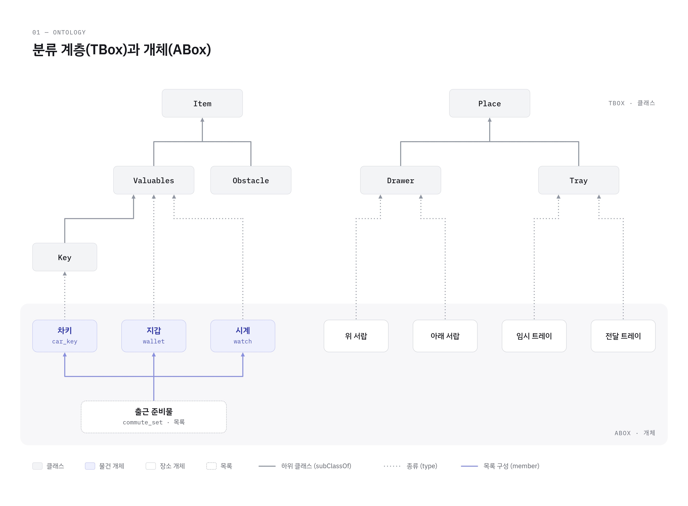
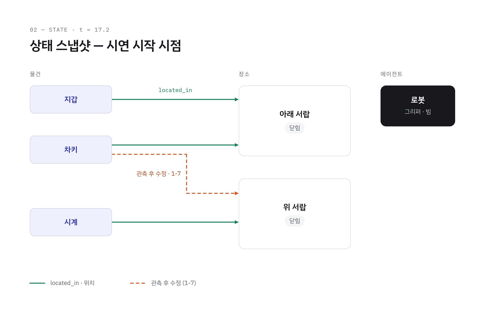
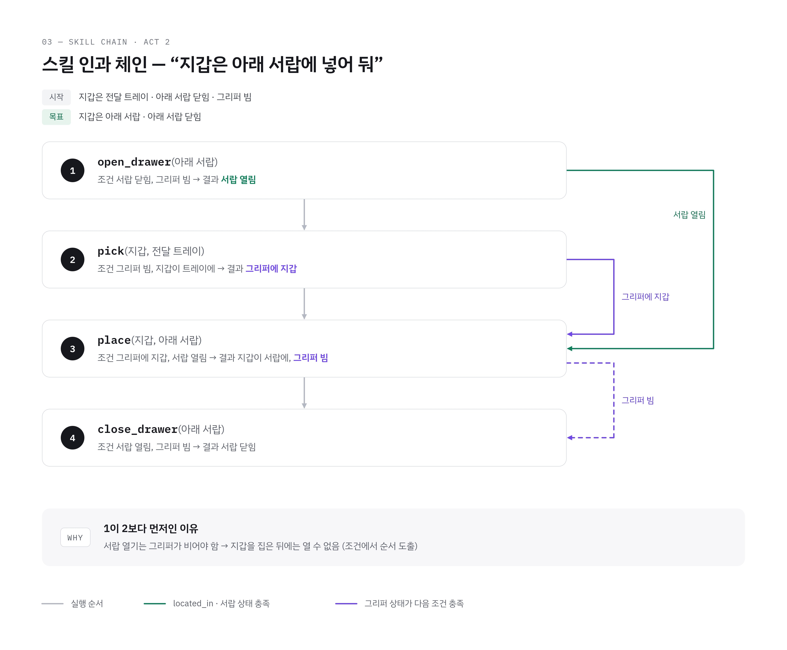

# 로봇 온톨로지 · 상태 추적 · 지식 그래프

> 요구사항 기준: [requirements.md](requirements.md). 이 문서는 기술 상세를 정의하며, 범위·Phase·완료 기준은 요구사항 기준 문서를 따릅니다.
>
> **Phase 범위**: **P1**: 세계·상태 + 이동·관측·서랍 열기·닫기·집기·놓기 스킬의 계약과 `pre`·`effect` · **P2**: 스킬 `verify`·`hold`, 온톨로지 조건·결과 기반 계획, 관측 우선 상태 갱신 · **P3**: 클래스 추론, 시작 시 정합성 검사, 복합 스킬 추가(코드 변경 없이), `STATE_MISMATCH` 시연. 7.9 지식 그래프는 초안. 범위는 [요구사항 기준](requirements.md#fr-ont-01).

## 7. 로봇 온톨로지 및 JSON 규격 (일부)

### 7.5 로봇 온톨로지 (동작 · 상태 · 세계, JSON-LD)

강사 챌린지의 중심. 로봇이 **할 수 있는 동작(skills)**, **현재 상태(state)**, **다루는 세계(world)**를 하나의 온톨로지로 정의하고, 플래너·Runner·LLM 파서·로거가 모두 이 파일을 기준으로 동작함.

> **원본 파일**: [`knowledge/robot_ontology.jsonld`](../knowledge/robot_ontology.jsonld) — JSON은 문서에 중복하지 않고 원본 파일만 유지함.

* **classes / world**: 물품·리스트·장소의 지식 (기존 물품 지식 베이스는 여기로 통합). `lists.*.items`에 쓰인 키는 반드시 `world.items`에 정의되어야 함(로딩 시 검증).
* **state**: 로봇과 세계의 **현재 상태**. `상태[predicate][subject] = value` 한 가지 형태로 통일(예: `open.drawer_top`, `located_in.watch`, `gripper.robot`). 서랍과 트레이를 `open` 하나로 다뤄 "집거나 놓을 수 있는 곳인가"를 단순하게 판단함.
* **skills**: 로봇 동작의 정의.
  * `primitive` 스킬: **실행 조건(`pre`)·실행 중 유지 조건(`hold`)·결과(`effect`)·관측 확인 기준(`verify`)·원자 동작 전개(`expand`)·발생 가능 에러**를 가짐. 조건·결과는 모두 `{subject, predicate, op, value}` 레코드 형식으로 통일. 플래너가 조합에 사용함.
  * `hold`는 스킬 실행 중 주기적으로 확인(예: 집는 동안 서랍이 열려 있어야 함). 깨지면 즉시 중단하고 `HOLD_VIOLATED` 기록.
  * `composite` 스킬: 7.3 같은 태스크 JSON을 하나의 스킬로 등록. 결과가 관측에 따라 달라지는(`effect: "sensing"`) 탐색형 작업은 플래너 조합 대상이 아니라 인텐트로 직접 호출함.
* 물품 목록·`size_m`·`grip_force`·`max_travel_m`·`return_slot`은 예시값이며, Day 2 실물 파지 테스트와 서랍장 실측 후 갱신함(2.2, 2.3).
* **원천은 JSON-LD, PDDL은 내보내기만**: 조건·결과 레코드는 PDDL의 술어 형식과 1:1로 대응하므로, 여유가 있으면 PDDL 내보내기 스크립트로 "표준 플래닝 언어와 호환"을 증빙함. PlanSys2·SkiROS2 같은 외부 프레임워크 도입은 향후 과제로 둠(ROS 2 Jazzy 지원·C++ 부담, 선행 사례 보고서 참고).
* **파라미터 이름 규칙**: 스킬 파라미터가 원자 동작 파라미터(7.1)와 같은 대상을 가리키면 **같은 이름**을 씀(예: `drawer_id`). 스킬 수준에서만 쓰는 개념(`item`, `from`, `to`)은 `expand`에서 원자 동작 파라미터(`search_target`, `region`, `location`)로 명시적으로 매핑하며, 정합성 검사(아래)가 매핑 누락을 잡아냄.
* **목적지 종류에 따른 자동 처리**: `place` 스킬은 `location: "$to"`만 넘기고, 목적지가 서랍이면 `place_object` 백엔드가 서랍 좌표계·z 보정을 자동 적용함(7.1 `place_object`). 원위치 복구처럼 정확한 자리가 필요하면 태스크 JSON에서 `pose` + `frame: "drawer"`를 직접 지정함(7.3 `f1.4`).
* **시작 시 정합성 검사**: 로딩 시 ① 모든 스킬에 실행 구현이 있고 그 역도 성립, ② 모든 조건이 존재하는 상태 경로를 참조, ③ 모든 에러 코드가 정의됨을 검증하고, 실패하면 Runner를 시작하지 않음.

### 7.6 새 작업 추가 = 온톨로지에 스킬 추가 (코드 수정 0줄)

* 새 작업은 `tasks/<이름>.json`(7.2 스키마) 파일을 추가하고 온톨로지 `skills`에 `composite`로 등록하면 끝. 파일에 `trigger`(인텐트 이름·예문)를 적으면 **LLM 인텐트 파서(6.4)의 프롬프트와 플래너에 자동 반영**되어 음성 명령까지 함께 추가됨.
* 새 원자 수준 능력은 `primitive` 스킬로 추가(예: "트레이 흔들어 정렬하기"). 기존 원자 동작의 조합으로 `expand`를 적을 수 있으면 역시 코드 수정이 필요 없음.

> **원본 파일**: [`tasks/return_items.json`](../tasks/return_items.json) — JSON은 문서에 중복하지 않고 원본 파일만 유지함.

> 위 예시의 `sequence`는 지면상 첫 스텝만 표기. 시연 2막(17.4)의 "정리해줘"가 이 방식의 증빙임.

### 7.8 상태 추적 규칙 (담당 C, 온톨로지 데이터 E)

* **Runner가 상태의 단일 관리자**. 스킬 실행 전 `pre`를 확인하고(`PRE_UNMET`이면 실행하지 않음), 실행 중 `hold`를 확인하며, 액션 성공 후 `verify` 관측이 통과해야 `effect`를 반영.
* **관측이 우선**: `inspect_region` 결과(물품 위치), `/drawers/state`(서랍), `/gripper/state`(그리퍼)가 상태와 다르면 **관측값으로 고치고 `STATE_MISMATCH`를 로그**에 남김. 1막의 차키 위치 자동 수정도 이 규칙으로 동작함.
* 현재 상태는 `/robot_state` 토픽(JSON)으로 계속 발행 → 시연 화면·Isaac Sim 트윈이 사용.
* 상태는 DB에 저장하여 작업 사이에 유지됨(2막에서 1막의 수정 결과 사용).

### 7.9 지식 그래프 (초안)

7.5 로봇 온톨로지를 그림으로 나타낸 초안. 물품·시나리오가 확정되면 최종본으로 한 번에 다시 그림(원본: 팀 공유 `지식 그래프_초안.pdf`).

**① 분류 계층(TBox)과 개체(ABox)** — 하위 클래스(실선), 개체의 종류(점선), 목록 구성. "귀중품 다 찾아줘"는 Valuables 아래 개체를 따라가는 추론으로 처리됨.

**② 상태 스냅샷 — 시연 시작 시점(17.2)** — `located_in` 기록과, 1막 1-7에서 관측 후 수정되는 차키 위치(주황 점선).

**③ 스킬 인과 체인 — 2막 "지갑은 아래 서랍에 넣어 둬"** — 각 스킬의 결과가 다음 스킬의 조건을 채우는 관계. 서랍을 먼저 여는 순서가 조건에서 도출됨(7.7).

> **최종본 작성 시 확인**: Day 2 파지 테스트로 확정된 물품, 실제 서랍·트레이 구성, 17.2 초기 배치, 2막 명령 문장, 그림 속 용어(`located_in`, `open`, `gripper`)와 7.5 온톨로지 키 일치.
