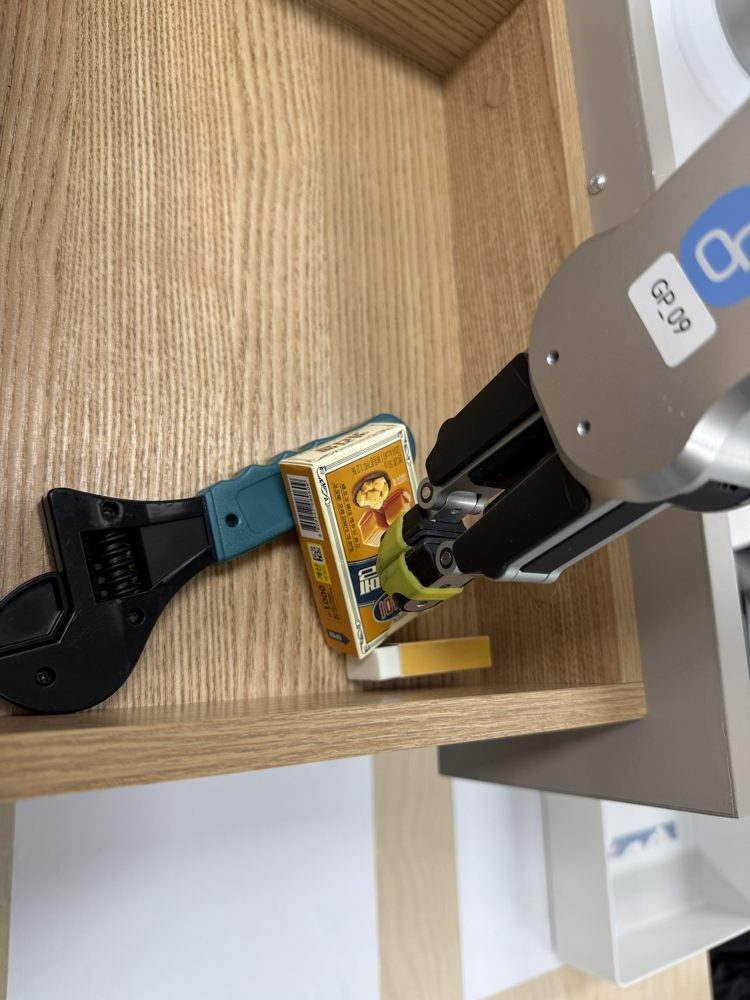
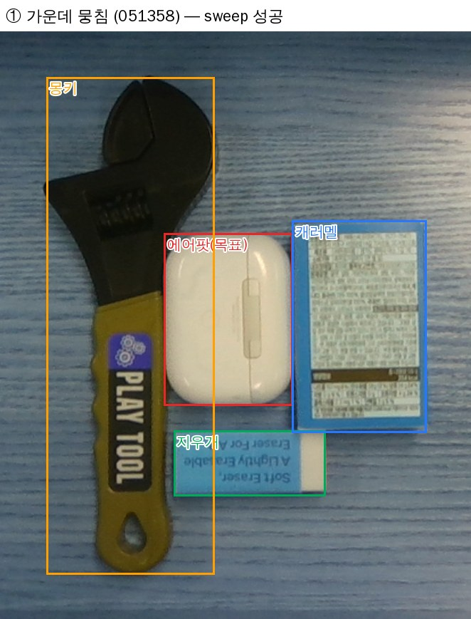
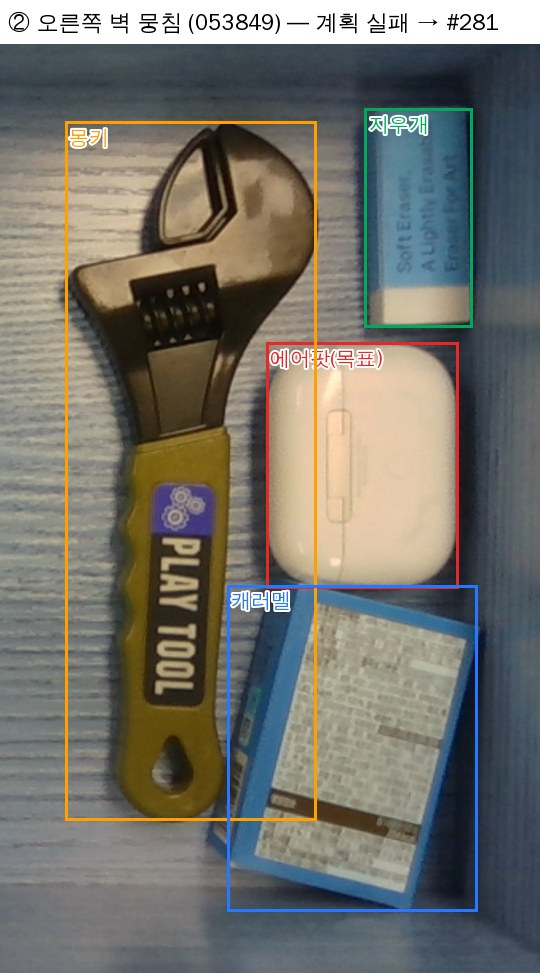
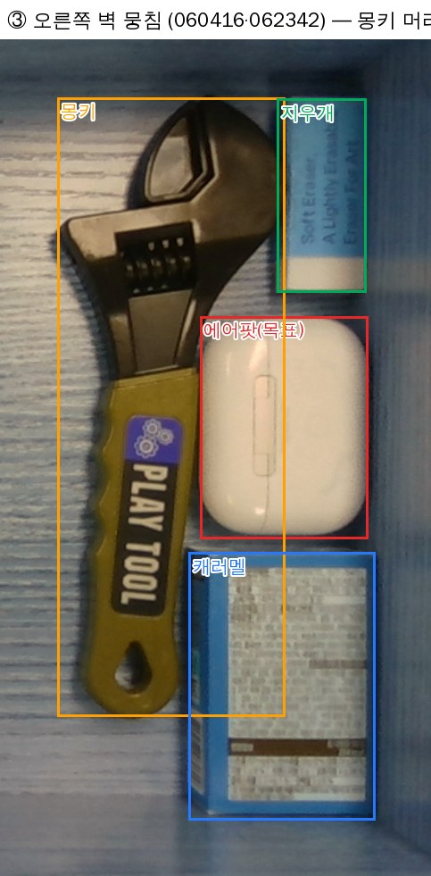
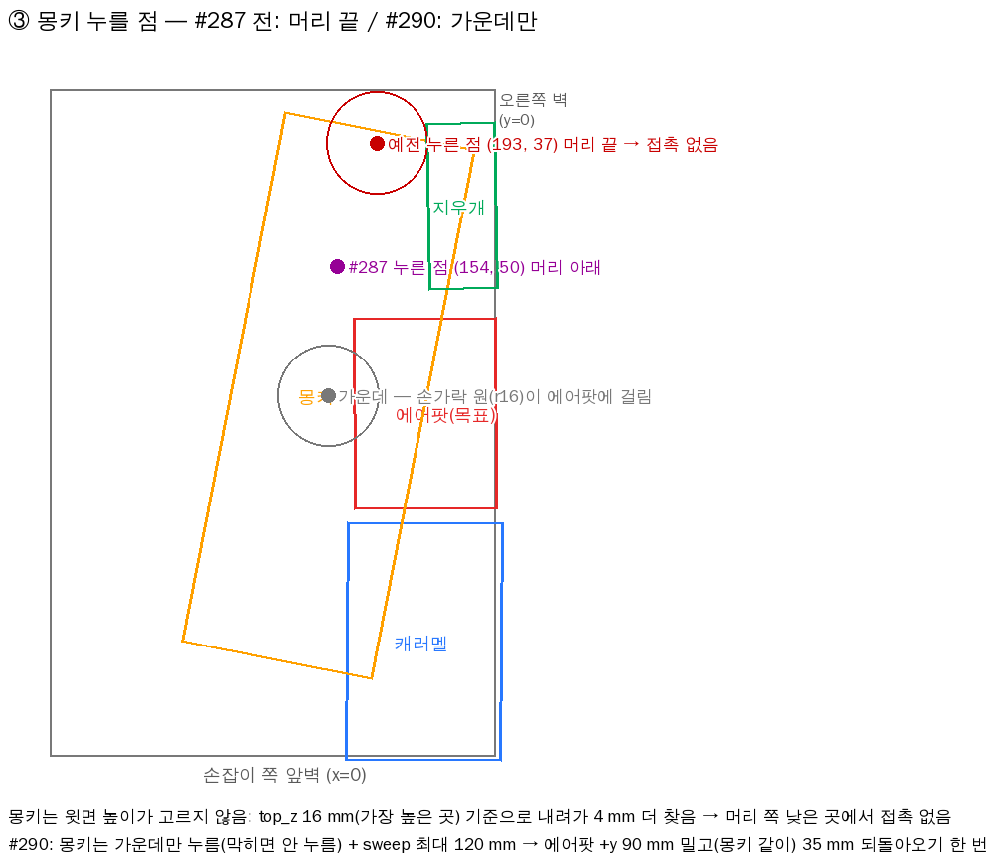
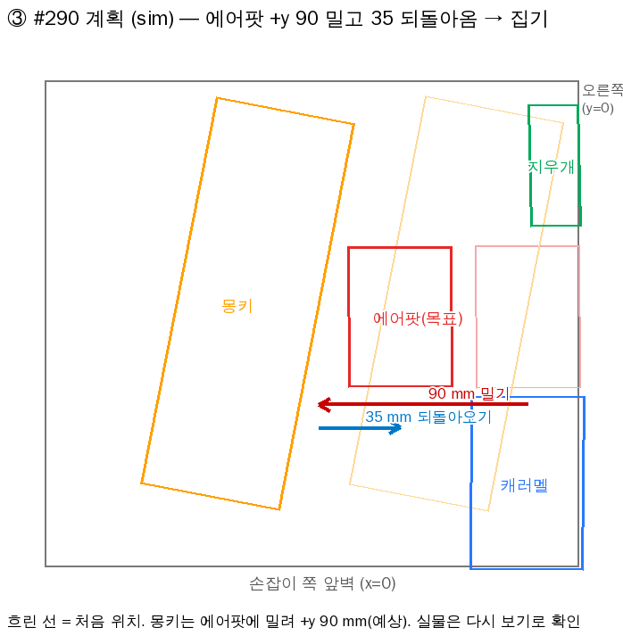
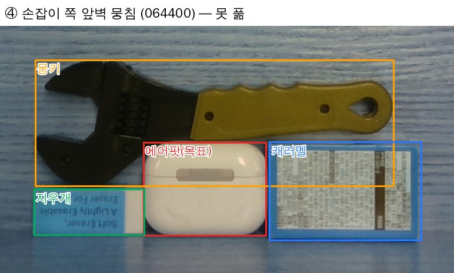
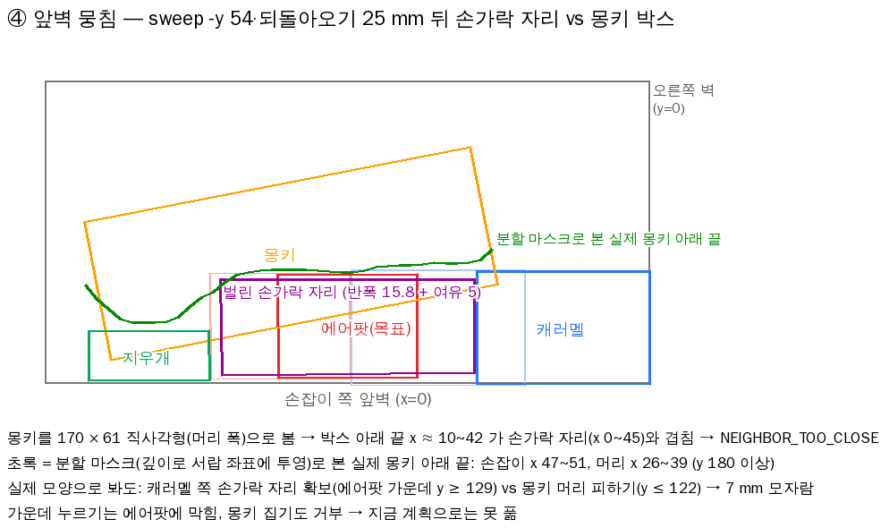

# 2026-10-13 B 실습 기록 (PC2 실물 — 쌓인 물체 넛지·무너뜨리기·불안정 쌓기·덮개 판 밑/위 물체)

- 10/13 새벽: PR #258 머지(`2c69662`). 쌓인 물체 넛지, 무너뜨리기(`topple`), 열기 전 쥔 물체 거부. 트레이 집기는 PM 결정(반납은 P3)으로 빼서 P2 시연 뒤 별도 PR(`0a94aa7` 에 보존).
- 10/13 오전: #260(B 동작 계약 규칙 R1~R8·순서도), #261(A `top_z` 보정) B 리뷰.
- 10/13 낮: 3차 챌린지 날이라 **B Python 동결**. 실물은 확인만, 고칠 것은 챌린지 뒤 B PR 로.
- 10/13 오후: 덮개 판 밑·위 물체 실물(아래 칸 `B unpack bottom 지우개`, putback) → B 수정 PR #265(`85d69e1`)·#274(`d648c3c`) 머지, README 스킬 서버 중복 기동 안내 #272(`11e1f8e`). 머지는 사용자 허락("걍 머지해도 됨"). **PC2 는 챌린지 기준 `e22a0af` 그대로 — 오늘 수정은 챌린지 뒤 pull 해야 반영.** 변경·높이 출처 정리는 [#260 B 업데이트](https://github.com/Jik-Kim/ready2go/issues/260#issuecomment-6138494685).
- 10/13 저녁: **둘러싸인 물체 집기**(`B clear`, 아래 14~21) — #278·#280·#281·#284·#287·#290 머지(`c60b760`). 가운데 뭉침·오른쪽 벽 뭉침 **실물 성공**, 손잡이 쪽 앞벽 뭉침은 못 풂(실제 모양으로 봐도 7 mm 모자람). PC2 는 챌린지 뒤 main 을 받아 씀(임시 수정 되돌림).
- 결론 [사용자 10/13]: 쌓인 것은 **넛지로 충분**(무너뜨리기 필요 없음 → #265 에서 뺌). **불안정하게 기대 쌓은 배치는 못 함** → 시연 배치에서 빼고 발표 "개선 사항"으로.

## 트러블슈팅 (10/13) — 증상 → 원인 → 조치

### 쌓인 물체 넛지 (위 칸 3단: 렌치 ← 캐러멜 ← 지우개)
1. **`B nudge top`·`B topple top` 둘 다 `NO_OBJECT_CONTACT` (누르기 3번 모두)** [실측 PC2]
   - 장면(`B scan top 지우개`): 지우개 (84.1, 269.3) mm 윗면 48.9 mm, 캐러멜 (84.7, 264.7) 38.8 mm `occluded_by ['eraser#1']`, 렌치 (98.0, 254.9) 15.8 mm yaw 믿을 수 없음. 같은 장면에서 `B pick top` 은 `WALL_TOO_CLOSE`.
   - 처음 판단(틀림): 지우개가 기울었다 → 사용자 "개평평해". 사용자 관찰 "지우개 누르다가 올라갔어 분명 닿았는디".
   - 원인 [실측 + 추정]: 빈 종이 상자(캐러멜)가 눌리면 휨. 닿아서 멈춘 뒤 확인 3번(`press_confirm` 3) 동안 힘이 `touch_force_n` 5 N 아래로 빠짐. 예상 접촉 높이 아래로 더 찾는 거리 `search_below_mm` 4 mm 로는 휘는 만큼 못 내려감 → 닿았는데 "안 닿음"으로 3번 올라옴.
   - 조치(PC2 로컬 임시, 커밋 안 함): `drag.search_below_mm` 4 → 12, `drag.contact_z_tol_mm` 3 → 12 → **넛지 성공**.
   - 결과 [실측 PC2, 사용자 "넛지 성능 개확실하네"]: 무너지지 않고 **3개 전부 같이 끌려옴**(마찰). 그 뒤 `B pick` 으로 지우개 집기 성공.
   - 되돌림: 챌린지 기준 커밋 `e22a0af`(#261 머지 뒤 PC2 맞춤) 전에 `git checkout -- ros2_ws/src/ready2go_skills/params/skills.yaml`. 그래서 지금 main 값(4 mm)으로는 쌓인 물체 넛지가 다시 실패할 수 있음 — 챌린지 경로(`show_drawer`·`move_aside`)에는 없음.
   - 남음(챌린지 뒤 B PR): 쌓인 물체일 때만 더 깊이 찾기(받침 윗면까지 또는 약 12 mm), 확인 조건 완화 검토.

2. **무너뜨리기(`topple`)는 빼기로** [사용자 10/13 "높이 상관없이 넛지가 되면 topple 필요가 있나?"]
   - 1번처럼 넛지가 쌓인 그대로 끌어 오고, 끌려온 뒤엔 맨 위만 집으면 됨. 놓을 자리는 `free`.
   - 무너뜨리기는 떨어진 물체가 어디로 갈지 모름(#254 위험)이라 넛지보다 불확실.
   - 조치(이 PR, 머지는 챌린지 끝난 뒤 — Python 0줄 기준 `e22a0af` 보호): `nudge_object` `topple`·`core/clear_plan.topple_move`·`below`, `make_room` 무너뜨리기 대안(놓을 자리가 없으면 다시 `NO_FREE_SPACE`), `B topple`, `make_room.topple_extra_mm`·`topple_gap_mm`, 계약 예시 `topple_*`·`make_room_topple`, `tools/validate_contracts.py` `topple_errors`, runner.md·README 제거. 남긴 것: 쌓인 물체 누르는 높이를 받침 위로(`_press_move`, 쌓인 넛지·`make_room` 넛지가 씀), `_room_objs`·`_room_cfg` 정리. 시험 656 → 648 passed(무너뜨리기 9개 빼고 `make_room` 놓을 자리 없음 → `NO_FREE_SPACE` 움직이기 전 1개).
   - 남음: #258·#260 의 무너뜨리기 제안은 댓글로 철회.

### 불안정하게 기대 쌓은 배치
3. **캐러멜 상자를 렌치 손잡이·지우개에 비스듬히 기대 세운 배치 → 못 함** [실측 PC2, 사용자 "당근펜보다 험한게 나와버렸다 … 절대 못한다"]

   

   - 장면(사진): 렌치는 바닥에, 캐러멜 상자는 렌치 손잡이와 그 아래 지우개에 걸쳐 기울어 섬(윗면이 평평하지 않음). 손가락이 기운 상자 모서리에 닿음.
   - 못 하는 이유 [추정, 코드 기준]:
     - 비전 결과(`pose`)는 위치·**yaw 만** 있고 기울기(roll·pitch)는 없음. 그래서 B 는 기운 걸 알 수 없음.
     - B 는 모든 물체가 받침 위에 **평평하게** 있다고 봄: 받침 높이 = `top_z` − 온톨로지 높이, 누르는 높이·손가락 높이도 여기서 나옴. 기운 상자는 `top_z`(p95)가 높은 모서리라 받침·누를 점이 다 틀어짐.
     - 넛지는 윗면을 눌러 마찰로 끄는 방식이라, 기운 면을 누르면 미끄러지거나 상자가 넘어감. 집기는 평행한 두 옆면을 수직으로 잡는다고 보는데, 기운 상자는 옆면이 기울어 손가락이 미끄러짐.
     - 쓰러지면 어디로 갈지 모름 — 당근 펜(굴러감, 10/06)보다 나쁨.
   - 조치(시연 운영): **시연 배치에서 기대 세우기·모서리 걸치기 금지.** 쌓을 땐 아래 물체 윗면에 완전히 올려 평평하게(10/12 S1 렌치 ← 캐러멜 ← 차키처럼). 코드는 안 고침(동결, 그리고 P2 범위 밖).
   - 발표 "개선 사항"으로(아래 절).

### 덮개 판 밑 물체 (아래 칸 `B unpack bottom 지우개`)
5. **판 집기 `NEIGHBOR_TOO_CLOSE` "벌린 손가락 자리에 lip_balm#1"** [실측 PC2, 2회]
   - 장면: 판 (94.8, 204.2) mm yaw −0.016, 판 밑 지우개 (98.0, 156.3)·립밤 (76.0, 151.3) 둘 다 `occluded_by ['cover_plate#1']`, 립밤 yaw 모름. 다른 회차엔 판 (132.6, 195.7) yaw 81° → `WALL_TOO_CLOSE`(아래 칸 수직으로 닿는 깊이 `drawer_reach_x_mm` 129 넘음).
   - 원인 [이 scan 으로 재현]: 판 손끝 20 mm, 판 밑 립밤은 온톨로지 높이 20 mm 로 보고 "손끝 − `fingertip_clear_mm` 2 = 18 mm 이하"여야 통과.
   - 조치 1 (PC2 임시, yaml): `neighbor.fingertip_clear_mm` 2 → 0 — 모든 집기에 적용, 회차 전 되돌림.
   - 조치 2 (이 PR) [사용자 10/13 "립밤 들어가도 그냥 집게", "몽키·망치도 — 넓이가 다리 사이보다 작으면 들어감"]: 분할 모델이 판 밑이라고 한(`occluded_by` 판) 물체가 다리 안쪽(65 × 35 mm, #8) 사이로 지나갈 폭이면 판 집기 손가락 확인에서 뺌. 판 짧은 변 쪽으로 가로지르면 폭 ≤ 65, 판 긴 변과 나란하면 ≤ 35, 방향 모르면 65. 폭은 외접 짧은 변, 잡는 부위 폭(`item_grasp` 몽키 25.9·망치 15.5)이 있으면 그것 — 머리는 판 밖으로 삐져나와도 손잡이가 지나감. 관측 윗면이 max(판 밑 21, 자기 높이) + 5 mm 넘으면(판 위 등) 안 뺌. 관계 모름(null)은 예전 규칙. `pick.under_gap_by_class_mm.cover_plate: [65, 35]`.
   - 한계 [추정]: 손끝(표 값 20 mm)은 판 아랫면(21)보다 낮을 수 있어, 판 밑 물체가 손가락 바로 밑으로 삐져나와 있으면 스칠 수 있음.

6. **가림판 원상복구 → 원래 자리에 립밤 있어 `PLACE_BLOCKED`** [실측 PC2, 사용자 "원복 때도 판 밑엔 물건이 들어갈 수 있다"]
   - 조치(이 PR): 판을 명령한 pose 로 되돌릴 때, 판 밑으로 들어가는 물체는 놓기 확인·받침에서 뺌 — 네 다리 자리(판 footprint 중 다리 안쪽 65 × 35 밖 모서리)와 안 겹치고, 판 아랫면(21) 밑 높이(온톨로지 ≤ 21 또는 손잡이로 지나가는 몽키·망치), 관측 윗면 ≤ max(21, 높이) + 5. 다리 자리에 걸리면 `restore_fit_max_mm` 안에서 비켜 놓음. 빈 자리·고정 자리(slot)·찾는 목표는 그대로 막음.

7. **덮개 판 위 물체 높이 — 판 면(약 29) / 나사 머리 위(약 40)** [사용자 10/13 사진 9장: 차키는 나사 사이 판 면에도, 뒤쪽 나사 둘 위에도, 에어팟은 앞쪽 나사 위]
   - 문제 [코드 확인]: ① 판 위 물체를 집을 때 받침을 판 온톨로지 높이(40.5, 나사 포함)로 써서 판 면 위 차키는 너무 높게 잡음. ② 원래 자리로 되돌릴 때 받침 = 판 비전 top_z(나사 머리, 약 35) → 판 면 위였으면 6 mm 높게, 나사 위였으면 5 mm 낮게.
   - 조치(이 PR): ① 받침이 다리 있는 판이면 온톨로지 대신 물체 자기 윗면 − 자기 높이(비전) — 나사가 가려져도 상관없음(물체 윗면이 곧 놓인 높이). ② 집을 때 자리·받침 높이를 서버가 기억(`picked_from`, 최근 12개, 재시작하면 비움) → 같은 자리(3 mm·5°)로 되돌리면 그 높이로. 판 위 새 자리에 놓기는 아직 없음(`free` 는 바닥만) — 필요해지면 나사 위치 실측으로 기하 계산.

8. **덮개 판 위 물체 putback → `PLACE_BLOCKED` "놓을 자리가 cover_plate#1 와 겹침"** [실측 PC2 `e22a0af`, 사용자 "판 위 너무 잘 집는데 putback 이 안 됨"]
   - 원인 [코드]: 다른 물체 위에 놓을 때 받침은 놓을 물체 **가운데**가 받침 footprint 안일 때만 찾음(`place_plan.stack_support`). 판이 위 물체에 가려 판 비전 위치·각도가 치우치거나(A 10/13 "가려진 물체는 보이는 쪽으로 치우치고 90° 돌 수 있음"), 물체가 판 끝 나사에 걸쳐 가운데가 판 밖이면 판을 못 찾고 이웃으로 막음.
   - 조치(#274): 집었던 자리(7번 `picked_from`)로 되돌릴 땐 그 자리 몸통과 겹치는 물체를 받침으로 보고 확인에서 빼고, 높이는 집을 때 받침 높이. 기억 없는 다른 자리는 예전처럼 막음. 실물 확인은 챌린지 뒤.

9. **아래 칸 판 집기 `WALL_TOO_CLOSE` "앞뒤 벽에 걸려 짧은 변으로 못 잡음"** [실측 PC2 12:02, A Isaac 사전 검증 `030225`]
   - 원인: 벽이 아니라 깊이 한계 — 판 가운데 x 132.6 mm > `drawer_reach_x_mm.drawer_bottom` 129(아래 칸은 위 서랍장에 막혀 수직으로 닿는 깊이). 판이 81° 돌아 손가락도 앞뒤(x)로 벌어짐.
   - 조치: 배치 규칙 — 판 가운데 x ≤ 120 mm, 긴 변을 서랍 x 로(C #273 체크리스트). 문구를 나눔(#274): "물체 가운데 x … mm 가 수직으로 닿는 깊이 129 mm 밖 (아래 칸은 위 서랍장에 막힘)". 코드 `WALL_TOO_CLOSE` 그대로. 치울 물체(판)는 Runner·`B unpack` 둘 다 넛지하지 않음 → C 판단.

10. **`B unpack` 치운 물체 aside → free** [사용자 10/13 "free 가 상위호환, aside 다 지우자"]
   - `B unpack` 은 `slot: "free"` 하나(서버가 집는 물체 자리는 빈 것으로 보고, 목표 둘레 비우고, 놓은 뒤 다시 집을 수 있는 자리 먼저). 빈 자리 없으면 든 채 멈춤(B 스크립트는 집기 전 판단 없음 — Runner 는 #250). `B aside`·`aside2` 삭제(#265). 서버 aside slot 은 C `find_with_unpack` 이 써서 남김.
   - 오늘 PC2 는 `b_sk.py` 한 줄 임시 수정(`for slot in ("free",)`)으로 시험 — 회차 전 되돌림.

11. **구석에 세운 지우개(안쪽 오른쪽 구석, 세로로) — 넛지 시도조차 안 함** [실측 PC2, 사진]
   - [추정] B 는 세운 지우개를 윗면 52.5 → 받침 41 mm 위에 쌓인 물체로 봄. 누르는 높이는 맞지만, 누를 점·끌 방향을 누운 크기(52.5 × 22)로 계산해 움직이기 전 거부됐을 가능성. 원인은 Bserver 창 `[WARN]` 줄 필요 — 다음 시도 때 받기.
   - 방향: 비전 뎁스로 "세워짐" 판단(윗면 ≈ 다른 변 길이, 밑에 물체 없음) → 윗면 눌러 빈 쪽으로 끌어 눕히기 → 다시 보고 집기. 요구사항에 없음 — 챌린지 뒤 B 개선 후보.

12. **README 실물 실행 안내에 스킬 서버를 또 띄우는 명령** [#134 E 정기 검토 P1]
   - #266(`1e50db8`) 의존성 문서 정리 때 다시 들어옴(자동 서버 + 수동 서버 = `/skills/*` 둘). #272 로 지우고 서버 1개 확인(`ros2 node list | grep -c skill_server`)·콘솔 저장으로. B 의 `domain.md` 옛 넛지·복구 설명(P2)은 챌린지 뒤.

13. **실수: 내 PR(#274) 번호를 #273 으로 잘못 알고 C #273 에 머지 호출** [10/13 13:49]
   - 기록상 머지한 사람·시각은 이영훈(`tkdak2014-commits`) 13:49:34 — 내 호출과 같은 초라 누가 머지했는지 불확실. #273 은 로컬 CI 줄·리뷰 요청이 있던 C PR(`run_report` 가려진 물체 복구 오차 표시). 되돌리지 않고 이영훈 확인 요청.
   - 교훈: PR 만든 직후 머지는 만들기 결과의 번호로만.

### 둘러싸인 물체 집기 (`B clear` = `nudge_object make_room`, 위 칸 에어팟) — 오후 실물
사용자 목표 [10/13]: "물체가 뭉쳐 있을 때 넛지로 밀고 집기". C(이영훈)가 "둘러싸인 상태에서 집기 되면 알려 달라" 요청. 장면마다 PC2 덤프(`/dump/inspect_*.npz`)를 받아 같은 입력으로 sim(B 스킬 서버 실제 판단 코드 + 사전 검사, 로봇은 안 움직임)을 돌려 원인을 찾고 고침.

| # | 장면 (덤프) | 결과 | 원인 → 조치 (PR) |
| :--- | :--- | :--- | :--- |
| 14 | 가운데 뭉침 — 에어팟 둘레 캐러멜·몽키·지우개 (`051358`) | 처음 `NEIGHBOR_TOO_CLOSE`(계획 없음) → 고친 뒤 **성공** | 외접 박스끼리 처음부터 1~2 mm 겹쳐 어느 쪽으로도 0 mm → 처음 겹친 물체에서 멀어지는 쪽은 안 막음 (#278) |
| 15 | 같은 장면 실행 | 성공했지만 "넛지하러 갈 때 기울이는 게 너무 빨라 무섭다" → 줄였더니 "굼벵이" | 넛지 동작 속도 따로(`speed.nudge`, #280) → 평소 속도로 되돌림(`{}`, #284) |
| 16 | 같은 장면 | 캐러멜을 먼저 넛지한 뒤 에어팟 | 사용자 "에어팟만 sweep 하고 에어팟만 가져가면 안 되나" → `make_room.remove_first: false`(덜 움직이는 넛지·sweep 먼저, #280) |
| 17 | 오른쪽 벽 뭉침 (`053849`) | 계획 실패 "끄는 길에 caramel_box#1" | 옆에 맞붙은 물체를 '앞'으로 봄 + 14° 돈 캐러멜 박스가 벽 밖 4 mm → 앞 판정 원뿔·처음부터 벽 밖 만큼 봐줌 (#281) |
| 18 | 같은 배치 실행 | 몽키를 민 뒤 다시 봐도 각이 안 나와 **같은 sweep 반복** | 딱 통과하는 거리라 실측 오차에 다시 막힘 → `slack_mm` 10 더 밀기, `B clear` 같은 동작인데 목표가 5 mm 안이면 막는 물체 치우기 먼저(`remove_first`)로 바꾸고 또 되풀이면 멈춤 (#284) |
| 19 | 오른쪽 벽 뭉침 (`060416`·`062342`) | 몽키 **머리**를 누르러 가서 접촉 없음 ×2 (Ctrl+C) | 아래 ③ 그림 — 계획 sweep 이 0 mm(몽키 박스가 손잡이 쪽 캐러멜과 겹쳐 캐러멜까지 같이 미는 걸로 계산) → 몽키 먼저 넛지, 누를 점은 가운데가 에어팟에 걸려 긴 변 끝(머리)으로 → 같이 밀린 물체도 처음 겹침 봐줌·누를 점 폭 방향 비킴(#287) → 몽키는 **가운데만** 누름 + **sweep 최대 120 mm**(#290) |
| 20 | 오른쪽 벽 뭉침, 몽키를 조금 띄움 (#287 전 코드) | **성공** — 에어팟 sweep → sweep 한 번 더 → 집기 [사용자 "에어팟으로 잘 가서 스윕, 스윕 한 번 더 해서 내린 다음 잘 잡았음"] | 사이드(옆벽) 성공 예시. 덤프·사진은 사용자에게 받으면 추가 |
| 21 | 손잡이 쪽 앞벽 뭉침 (`064400`) | **못 풂** `NEIGHBOR_TOO_CLOSE` "벌린 손가락 자리에 caramel" | 아래 ④ 그림 — 지금 순서로는 못 풂(몽키 뒤로·옆으로·집기 다 막힘). sweep 만으론 실제 모양으로도 7 mm 모자람. 시연 배치에서 뺌. 몽키 벽 확인 손잡이 폭·치운 뒤 목표 움직이기까지 보기 (#294) |

**① 가운데 뭉침 — 성공 (14~16)**

**② 오른쪽 벽 뭉침 — 계획 실패 → #281 (17)**

**③ 오른쪽 벽 뭉침 — 몽키 머리 누름 → #287·#290 (19)**

- 왜 머리로 갔나 [코드]: 누를 점 후보가 가운데 → 긴 변 절반 → 끝 순서. 가운데는 손가락 원(반지름 16 mm)이 더 높은 에어팟(22.9 > 16.0 + 3 mm)에 걸려 다음 후보로 → 비전 yaw 로는 어느 쪽이 머리인지 몰라 먼저 나온 끝이 머리 (193, 37) mm.
- 왜 안 닿았나 [사용자 관찰 + 코드]: 몽키 윗면 높이가 고르지 않음(머리 입·나사·손잡이). `top_z` 16 mm 는 가장 높은 곳, 누를 때 예상 높이 아래 `drag.search_below_mm` 4 mm 까지만 찾음 → 낮은 머리 부분에서 "접촉 없음".
- 사용자 [10/13]: "sweep 먼저 한다며?", "옮기더라도 몽키 중앙 부분을 눌러야지". sweep 이 안 나온 이유: 벽 여유(38 mm) + 몽키 쪽 손가락 자리를 둘 다 만들려면 85 mm 넘게 밀어야 하는데 최대 80(`drag.max_shift_mm`).
- 조치 #290: `make_room.press_center_only_classes: [toy_wrench]`(가운데만, 막히면 안 누름), `make_room.sweep_max_mm: 120` [추정 — 120 mm 미는 동안 팔·힘 실물 확인 필요] → 이 장면 sim: 에어팟 +y 90 mm 밀고(몽키 같이) 35 mm 되돌아와 바로 집기.

- sim 무작위 뭉침(물체 3~5개, 목표 둘레 28~55 mm, 3 seed 약 350 장면): #284 333 → #287 341 → #290 341 성공. 몽키를 아예 안 누르게 하면 327 로 떨어져 "가운데만"으로. 남은 실패는 대부분 목표가 립밤(굴러서 긴 변 방향으로만 밂)이고 손가락 자리에 이웃이 붙은 경우.

**④ 손잡이 쪽 앞벽 뭉침 — 못 풂 (21)**

- 장면: 에어팟(90° 돌아 긴 변이 y)이 손잡이 쪽 앞벽(x 0)에 붙음, 왼쪽(+y) 지우개, 오른쪽(−y) 캐러멜, 뒤(+x) 몽키가 11° 기울어 바짝. 안쪽(+x)으로 끌기는 서랍이 닫혀서 안 함(`drag.push_inward_ok` false).
- 계획이 본 것 [sim]: 바로 잡기는 캐러멜이 손가락 자리. sweep −y(캐러멜을 오른쪽 벽까지 54 mm 같이) + 되돌아오기 25 mm 면 양옆 25~29 mm 생기는데, 손가락 자리(x 0~45 = 손가락 반폭 15.8 + 여유 5)가 몽키 외접 박스(170 × 61, 머리 폭을 길이 전체로) 아래 끝 x ≈ 10~42 와 겹쳐 거부. 몽키를 빼고 계산하면 집기 통과. 몽키 가운데는 에어팟에 막혀 안 누르고, 몽키 집기도 거부.
- **분할 마스크로 확인** [덤프 마스크 → 깊이로 서랍 좌표 투영]: 실제 몽키 아래 끝은 손잡이 x 47~51, 머리 x 26~39(y 180 이상). 실제 모양으로 봐도 캐러멜 쪽 손가락 자리를 만들려면 에어팟 가운데 y ≥ 129, 몽키 머리 쪽 손가락이 머리를 피하려면 y ≤ 122 → **7 mm 모자람**(여유 5 mm 를 0 으로 하면 2.6 mm 틈 — 비전 오차 2.5 mm 수준이라 못 믿음).
- "그냥 세그먼트로 보면?" [사용자 10/13]: B 는 비전 결과에서 가운데·yaw·class 만 받고 크기는 온톨로지 직사각형. 분할 마스크는 비전 안에만 있고 결과(`inspect_region`)엔 없음 → A 가 물체 외곽(서랍 좌표 다각형)을 결과에 넣고 B 가 이웃 확인·밀기에 쓰면 몽키·망치처럼 직사각형과 많이 다른 물건에서 정확해짐. 이 장면은 그래도 7 mm 모자라 못 풂.
- 사용자 [10/13]: "몽키부터 뒤로 옮기면?", "뒤로 안 되면 옆으로도?" — sim 으로 확인:
  - 뒤(+x, 안쪽)로 끌기: 안 함 — 손잡이 쪽 물체를 안쪽으로 끌면 서랍이 같이 닫힘 [실측 PC2 10/10, `drag.push_inward_ok: false`].
  - 몽키 집어 빈 자리로: 벽 확인을 머리 폭 61 로 해 "앞뒤 벽에 걸림" → 손잡이 폭(25.9)으로 고침(#294). 그래도 손잡이 어디를 잡든 아래쪽 손가락이 에어팟·캐러멜(더 높음)에 닿아 거부 — 실제로도 닿음.
  - 몽키 옆(±y)으로 넛지: 몽키 가운데는 손가락 원(반지름 16)이 더 높은 에어팟에 걸려 못 누름. 반지름을 8 로 줄여 눌러도, 몽키가 170 mm 라 옆으로 밀어도 직사각형이 에어팟 손가락 자리에 그대로 걸림. 실제 모양이면 몽키 +y 45 mm(머리를 지우개 쪽 손가락 자리 밖으로) → 에어팟 sweep 으로 풀림 [분할 마스크 계산].
  - 결론: 지금(직사각형)으로는 어떤 순서로도 못 풂. 분할 외곽이 있으면 "몽키 옆으로 → 에어팟 sweep" 으로 풀릴 가능성.
- 조치: 시연 배치에서 빼기 — 손잡이 쪽 앞벽 목표를 사방(특히 뒤에 큰 공구)으로 막지 않음. 개선은 아래 "개선 사항".

### `make_room` 판단 순서 (10/13 저녁 #294 기준) — "안 되면 다음"
한 번 부를 때 동작 **하나**만 고름 → 실행 → 탑뷰에서 다시 보고 다시 부름(`B clear` 최대 12번). 판단은 전부 움직이기 전 사전 검사(실제 집기·놓기 검사 코드)로. 각 단계는 "이걸 하면 목표 집기 검사가 통과하나?"로 확인.

| 순서 | 할 일 | 안 되면 |
| :--- | :--- | :--- |
| 0 | 목표 위에 얹힌 물체 → 맨 위부터 집어 빈 자리(`free`) | 그 물체를 못 집으면 그 물체 둘레부터 공간 만들기 한 단계 |
| 1 | 지금 바로 집기 (짧은 변 → 긴 변 → 손잡이 쪽 벽은 기울여 긴 변, 립밤은 긴 변·옆벽 기울여) | 2 |
| 2 | 벽에 붙어 손가락이 벽에 걸림 → 벽 반대쪽 넛지 한 번으로 집히면 그것 | 3 |
| 3 | 목표를 누를 수 있나(손가락 원이 더 높은 이웃에 안 걸림) — 못 누르면 → 6 → 8 | 4 |
| 4 | **목표 한 번 움직이기**: 넛지(아무것도 안 밂)·sweep(옆 물체 최대 2개 같이 밀고 되돌아오기) 중 **덜 움직이는 것**, 같으면 −x(손잡이 쪽) → +y → −y. 고른 거리에 10 mm 여유(`slack_mm`) | 5 |
| 5 | 목표 두 번 움직이기(다른 축, 예: 뒷벽에서 빼고 → 옆벽에서 빼기) — 첫 동작만 하고 다시 보기 | 6 |
| 6 | 벽 넛지(아직 안 잡혀도 벽에서는 벗어남) | 7 |
| 7 | **막는 물체를 집어 빈 자리로** → 바로 집히거나, 그 뒤 목표 한 번 움직이면 집히는 것 (#294) | 8 |
| 8 | ① 거부 이유에 나온 물체를 집어 빈 자리 ② 목표 옆 물체(가까운 4개)를 넛지·sweep → 목표가 바로 집히거나(먼저), 그 뒤 목표 한 번 움직이면 집히는 것(#294) ③ 거부 이유 물체 둘레부터 공간 만들기(한 단계) | 9 |
| 9 | 실패 — 로봇 안 움직임, 이유 코드(`NEIGHBOR_TOO_CLOSE` 등)·이유 문장 | (`B clear` 멈춤) |

- 같은 동작인데 목표가 5 mm 안에서 그대로면(`B clear`): 다음 부름에 `remove_first` → 4 에서 넛지(안 밂)만 → **7·막는 물체 넛지 먼저** → sweep → 5 … 순서로 바꿈. 또 되풀이면 멈춤 (#284).
- 공통 제한: 안쪽(+x) 끌기 안 함(서랍 닫힘), 넛지 최대 80 mm·sweep 최대 120 mm, 같이 밀 물체 최대 2개, 덮개 판·위에 뭐가 얹힌 물체는 안 밂, 몽키는 가운데만 누름, 립밤은 긴 변 방향으로만 밂.
- sim(무작위 뭉침 3 seed 약 350 장면) 성공: #284 333 → #287·#290 341 → #294 346. 판단 시간 최대 1.7 s(95% 0.4 s, 이 컴퓨터).

### PC2 코드 맞추기 (#261 머지 뒤)
4. **#261(A `top_z` 높은 이웃 옆 번짐 보정) 머지 `e22a0af` → PC2 를 main 에 맞추고 "Python 0줄" 기준점** [C 체크리스트 0절]
   - [A·PM Slack 11:20] 챌린지 기준 커밋 `e22a0af`, **끝날 때까지 PC2 pull 안 함**.
   - 순서: 임시 yaml 되돌림(1번) → `git status --short` 비어 있음 → `git checkout main && git pull && git lfs pull` → `git rev-parse --short HEAD` = `e22a0af` → `sha256sum config/vision_params.yaml` 앞 12자 `718059ab0e38` → 비전 노드 다시 켬(v2 시작 줄) → 스킬 서버 다시 켬.
   - B 영향: 판 밑·옆 물체와 쌓인 아래 물체의 `top_z` 가 내려가고(맨 위는 그대로), 판 밑 물체에 `occluded_by: ["cover_plate#1"]` 이 붙을 수 있음. `under_smear_mm` 5 그대로([B 리뷰](https://github.com/Jik-Kim/ready2go/pull/261#issuecomment-6136422535)).
   - 주의: 덮개 판 배치에서 `B topple`·`B clear` 안 씀 — 다리로 서는 판을 "쌓인 물체"로 볼 수 있음(챌린지 뒤 B PR).

## 발표 "개선 사항" 후보 (B)

| 한계 | 지금 | 개선 방향 |
| :--- | :--- | :--- |
| 기대 세운·기운 물체 (3번) | 비전이 yaw 만 줘서 기운 걸 모름 → 평평하다고 보고 누르거나 집음. 시연 배치 규칙으로 피함 | 뎁스로 윗면 평면 맞춰 기울기 추정 → 기울면 움직이기 전 거부, 또는 손목 기울여 기운 면에 맞춰 잡기 |
| 휘는 물체 누르기 (1번) | 빈 상자가 휘어 접촉 판정 실패 → 찾는 거리 늘려서 됨(임시) | 쌓인 물체·종이 상자는 더 깊이 찾기, 힘이 아니라 힘 + 위치로 접촉 판정 |
| 쌓인 채 끌기 (1번) | 마찰로 3개 같이 끌려옴 — 이번엔 결과적으로 좋았지만 의도한 건 아님 | 끌기 전후 다시 보고 같이 끌린 물체를 계획에 반영(지금도 한 동작마다 다시 보기) |
| 직사각형으로 보는 물건 모양 (21번) | 비전은 가운데·yaw 만, B 는 온톨로지 직사각형 → 몽키(손잡이 26 mm, 머리 61 mm)를 길이 전체 61 mm 로 봐 손가락 자리를 막음 | 비전 분할 마스크 외곽(서랍 좌표 다각형)을 결과에 → 이웃 확인·밀기를 실제 모양으로 (A·B) |
| 윗면 높이가 고르지 않은 물건 누르기 (19번) | 몽키는 가장 높은 곳 기준으로 내려가 머리 쪽에서 접촉 없음 → 가운데만 누름 | 뎁스로 누를 점의 실제 높이를 써서 내려가기, 또는 누를 점을 평평한 곳에서 고르기 |
| 뭉친 물체 판단 (14~21번) | 규칙 탐색(한 동작 → 다시 보기) — 무작위 sim 약 97% | 여러 단계 탐색(이웃 넛지 → 목표 넛지), AI(LLM·VLM)가 후보를 내고 B 사전 검사로 확인 (작업표 lt1·lt2) |
| 굴러가는 원통 (10/06 당근 펜) | 대상에서 뺌(#262) | 굴리기를 동작으로 쓰기(10/06 계산: 손끝 이동의 절반만 굴러옴) |

## PC2 지금 상태 (10/13 저녁)
- 챌린지 뒤 임시 수정 되돌림(`git checkout -- ros2_ws/src/ready2go_skills/params/skills.yaml ros2_ws/src/ready2go_skills/scripts/b_sk.py`) → main pull. #290(`c60b760`)까지 받았는지는 `git rev-parse --short HEAD` 로 확인 필요.

## 남은 것
- 둘러싸인 물체: #290 실물 — 오른쪽 벽 뭉침 원래 간격(몽키 바짝)에서 `B plan top 에어팟` 이 sweep 한 번(90 밀고 35 되돌아옴)인지, 120 mm 밀기 동안 팔·힘. 성공하면 C(이영훈) Slack 알림. 사이드 성공(20번) 덤프·사진 받아 넣기.
- 챌린지 뒤 pull(`d648c3c` 이상) → Bserver 재시작 → 실물 확인: ① 판 밑 립밤 그대로 `B unpack bottom 지우개`(판 집기·free) ② 지우개 뺀 S3 — 판이 립밤 위로 원위치 ③ 판 밑 몽키(긴 변·가로) ④ 판 면 위 차키 + 판 밑 지우개 — 차키 집는 높이·판 면 위 복구 ⑤ 나사 위 차키 복구 ⑥ 판 위 물체 `B pick` → `B putback`.
- 다음 B PR: 쌓인 물체 넛지 깊이 찾기(1번), 세운 물체 눕히기(11번, 로그 받은 뒤), C #152 W1 상태 조회·W2 복구(잠금 해제)·정지 시각 `stopped_at`, pick 거부 결과에 막는 물체 id(A 제안), `docs/domain.md` 옛 설명 정리(#134 P2).
- 로컬 CI: #265·#274 는 샌드박스에 Docker 가 없어 못 돌림 → PC 에서 `bash tools/dev/ci_local.sh main` 한 번.
- 트레이 집기 P3 PR(`0a94aa7`) — P2 시연 뒤, 사용자가 말하면.
